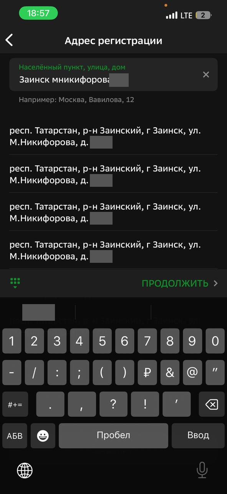
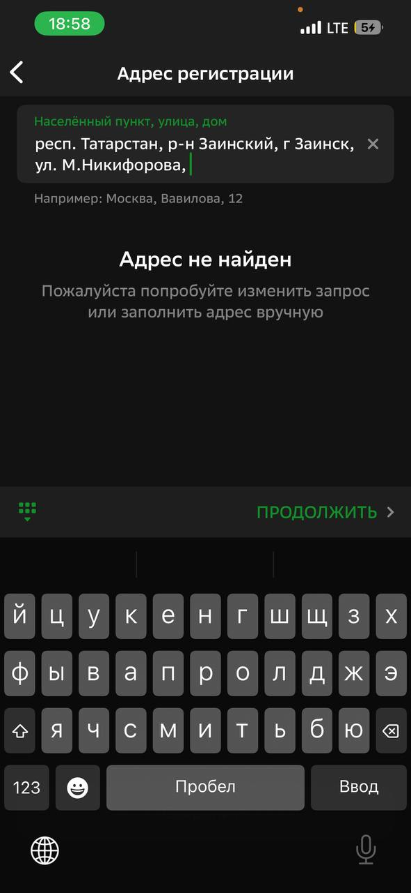
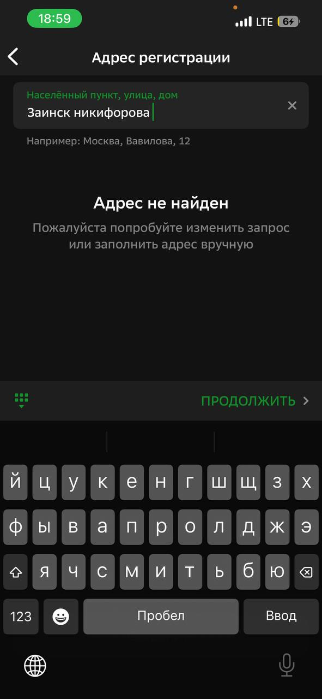
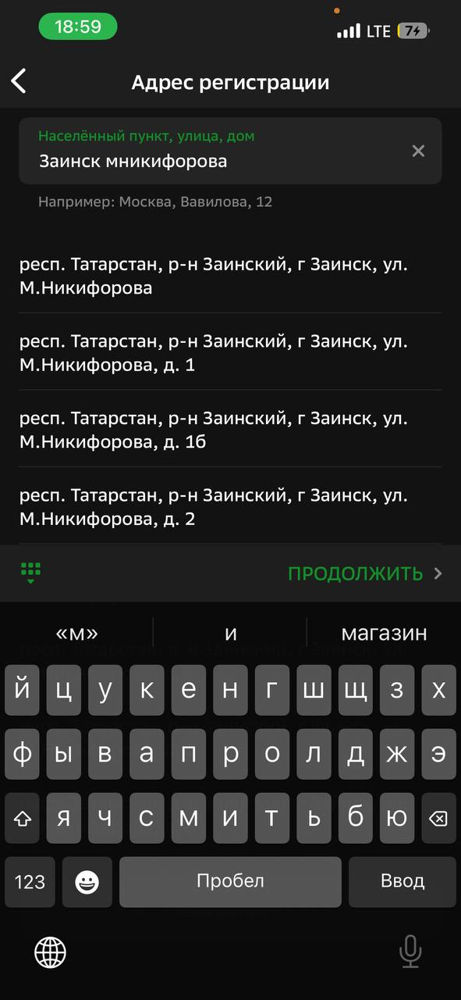

# BUG-01. ОСАГО → «Адрес регистрации»: ул. Никифорова (г. Заинск) не находится по полному названию

## Общая информация

| Поле | Значение |
|------|----------|
| Продукт | СберБанк Онлайн, мобильное приложение |
| Компонент | Оформление е-ОСАГО → шаг «Адрес регистрации» (адрес собственника ТС) |
| Устройство 1 | iPhone 13, iOS 26.5, СберБанк Онлайн 16.13.0 (3), сеть LTE |
| Устройство 2 | Samsung Galaxy A36, Android 16, СберБанк Онлайн 17.15.0 |
| Дата и время | 14.11.2026, 18:57–18:59 (скриншоты с устройства 1) |
| Воспроизводимость | Всегда (3 из 3 попыток), на обоих устройствах |
| Severity | Major |
| Priority | High |

## Предусловия

1. Пользователь авторизован в приложении и дошёл до шага «Адрес регистрации» при оформлении е-ОСАГО.
2. Адрес регистрации собственника по паспорту: респ. Татарстан, р-н Заинский, г. Заинск, ул. Никифорова, д. N.

## Шаги воспроизведения

| # | Действие | Фактический результат |
|---|----------|-----------------------|
| 1 | Ввести в поле «Населённый пункт, улица, дом»: `Заинск мникифорова N` | Подсказки отображаются: «респ. Татарстан, р-н Заинский, г Заинск, ул. М.Никифорова, д. N» и соседние дома |
| 2 | Очистить поле и ввести адрес в том виде, в каком система показала его в подсказке: `респ. Татарстан, р-н Заинский, г Заинск, ул. М.Никифорова` (проверено с запятой в конце и без неё) | «Адрес не найден. Пожалуйста, попробуйте изменить запрос или заполнить адрес вручную» |
| 3 | Очистить поле и ввести название улицы так, как оно записано в паспорте: `Заинск никифорова` | «Адрес не найден» |
| 4 | Очистить поле и ввести: `Заинск мникифорова` | Улица и дома по ней находятся |
| 5 | Ввести любой из запросов шагов 2–3 и нажать «Продолжить» | Кнопка визуально активна, но нажатие ничего не делает: перехода нет, сообщения об ошибке нет |

## Фактический результат

Улица находится только по слитной форме «мникифорова». По полному названию «никифорова» и по адресу,
введённому в том виде, в каком его показывает сама система (шаг 2), поиск возвращает «Адрес не найден».
Перебраны все варианты написания (с запятыми и без, с сокращением «М.» и без) — адрес находится только по
«мникифорова». Продолжить оформление полиса без этого нельзя.

## Ожидаемый результат

- По запросу «никифорова» в подсказках отображается улица Никифорова (М.Никифорова).
- Адрес, введённый в том виде, в каком система сама показывает его в подсказках, находится.

## Обоснование Severity и Priority

**Severity: Major.** Пользователь, который вводит улицу так, как она записана в паспорте, не может
найти свой адрес и продолжить оформление полиса: «Продолжить» не срабатывает, ручной ввод адреса тоже
не помогает. Обходной путь существует (ввод «мникифорова»), но он неочевиден: о слитной форме
пользователь догадаться не может.

**Priority: High.** Напрямую влияет на конверсию продажи ОСАГО и порождает обращения в поддержку.

## Локализация

- Проверено около 15 других улиц г. Заинска и соседних населённых пунктов — поиск работает корректно.
  Дефект относится к конкретной записи справочника (ул. Никифорова), а не к механизму поиска в целом.
- Дефект одинаково воспроизводится на iOS и Android в разных версиях приложения — значит, причина
  на стороне сервера или справочника адресов, а не клиентского приложения.

## Гипотеза о причине

Поиск находит только слитную форму «мникифорова». Вероятно, в поисковый индекс справочника адресов
(ФИАС/ГАР) попала только эта форма названия, а основная «Никифорова» — нет; либо нормализация запроса
не раскрывает сокращение «М.» при сопоставлении. Рекомендуется проверить запись улицы в справочнике
и логику нормализации запроса.

## Дополнительно

1. Связанный дефект: кнопка «Продолжить» не реагирует на нажатие, когда адрес не найден —
   [BUG-02](02-sber-osago-continue-button.md).
2. В подсказках улица отображается как «М.Никифорова», а в паспорте — «Никифорова». Даже после
   исправления поиска такое расхождение может приводить к ошибкам при сверке данных при оформлении полиса.

## Скриншоты

Скриншоты с устройства 1 (iPhone 13), номер дома скрыт.

| 1. «Заинск мникифорова N» — найдено | 2. Адрес из подсказки — не найден |
|:---:|:---:|
|  |  |
| **3. «Заинск никифорова» — не найдено** | **4. «Заинск мникифорова» — найдено** |
|  |  |
